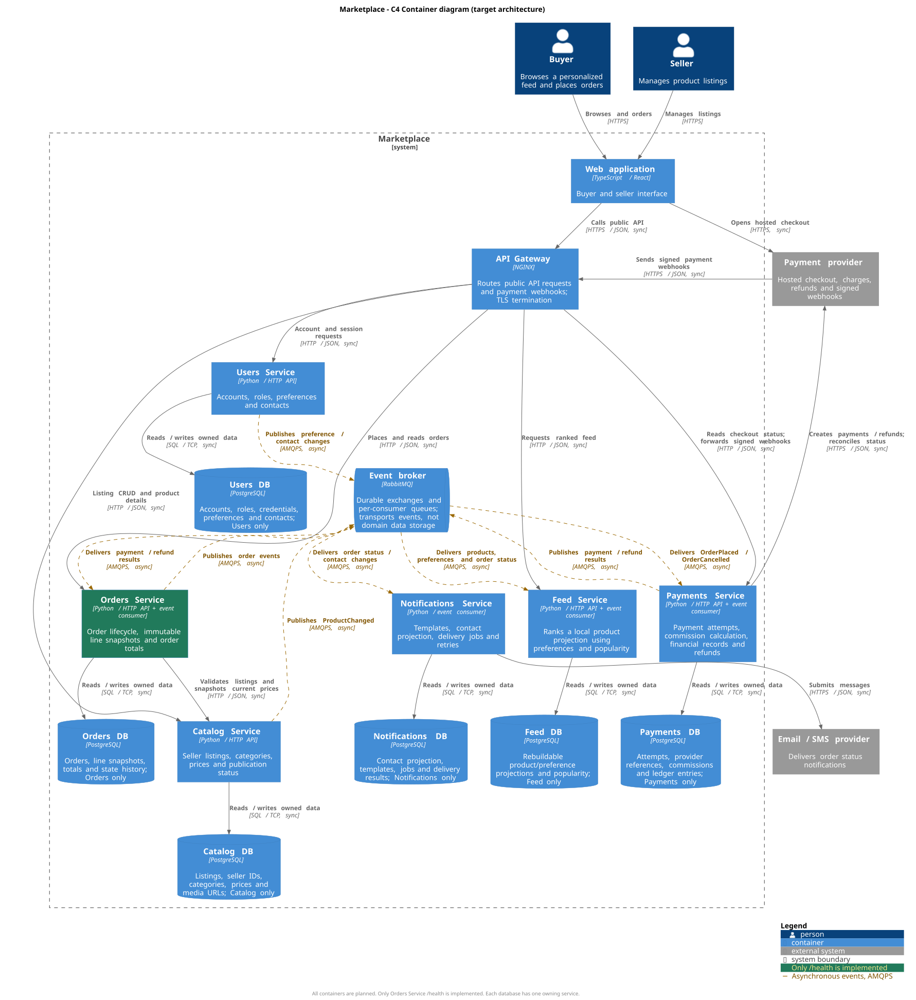

# Маркетплейс: архитектура C4 и запуск сервиса

Учебный проект по архитектуре цифрового маркетплейса. Покупатели получают персонализированную ленту и оформляют заказы, продавцы управляют товарами, платформа учитывает платежи и отправляет уведомления.

**Граница работы:** архитектура спроектирована для всей системы, но реализован только технический каркас **Orders Service** на Python с `GET /health`. Бизнес-логики, бизнес-эндпоинтов, подключений к БД, брокеру или платёжному провайдеру в коде нет. Описанные ниже API, события и алгоритмы являются проектными решениями, а не реализованными возможностями.

## 1. C4 Container



[Открыть диаграмму в полном размере](docs/architecture/container.svg) · [Исходник C4-PlantUML](docs/architecture/container.puml)

Это уровень **C4 L2 (Container)**: показаны граница маркетплейса, покупатель и продавец, приложения, отдельные хранилища, внешние системы, технологии и направления взаимодействий. C4-контейнер означает приложение или хранилище, а не обязательно Docker-контейнер.

Обозначения: синие элементы - проектируемые контейнеры; серые - внешние системы; зелёный Orders Service - единственный сервис с реализованным каркасом. Сплошные стрелки обозначают синхронные запросы, пунктирные - асинхронные события. Ответ на синхронный запрос подразумевается обратным направлением и отдельно не рисуется. Протоколы указаны на стрелках, условные обозначения есть на самой диаграмме.

**В Docker Compose запускается только Orders Service.** Базы, брокер, интерфейс и остальные сервисы показаны на целевой диаграмме, но не запускаются и не нужны для выполнения `/health`.

## 2. Быстрый запуск

### Docker Compose

Нужны Docker Engine и Docker Compose v2+ с поддержкой `--wait`. На Windows подойдёт запущенный Docker Desktop в режиме Linux containers. Локально устанавливать Python для этого способа не требуется. При первой сборке нужен доступ к Docker Hub.

Из корня репозитория:

```sh
docker compose up --build --detach --wait --wait-timeout 120
docker compose ps
```

В VS Code запуск также доступен через задачу `Docker: start orders` из [.vscode/tasks.json](.vscode/tasks.json).

После успешного запуска контейнер должен иметь состояние `healthy`. Проверка в Linux/macOS:

```sh
curl -i http://localhost:8080/health
```

Проверка в Windows PowerShell:

```powershell
curl.exe -i http://localhost:8080/health
```

Ожидаемый результат, без изменяемых заголовков `Date` и `Server`:

```http
HTTP/1.0 200 OK
Content-Type: application/json; charset=utf-8

{"status": "ok", "service": "orders"}
```

Также можно открыть [http://localhost:8080/health](http://localhost:8080/health) в браузере. Это технический JSON-ответ, не пользовательский интерфейс.

Логи и остановка:

```sh
docker compose logs orders
docker compose down
```

Если порт 8080 занят, создайте локальный `.env` по образцу [.env.example](.env.example) и задайте `ORDERS_PORT=8081`. Повторите запуск; health-check с хоста будет доступен на порту 8081. Внутри контейнера порт остаётся 8080. Compose публикует порт только на `127.0.0.1`.

Если Docker сообщает, что не может подключиться к daemon, сначала запустите Docker Desktop / Docker Engine. Если контейнер не становится `healthy`, проверьте `docker compose logs orders` и `docker compose ps --all`.

### Только Docker, без Compose

```sh
docker build -t marketplace-orders:local .
docker run --detach --name marketplace-orders -p 127.0.0.1:8080:8080 marketplace-orders:local
docker inspect --format '{{.State.Health.Status}}' marketplace-orders
docker stop marketplace-orders
docker rm marketplace-orders
```

Состояние `starting` в первые секунды нормально: встроенная проба запускается каждые 5 секунд. Не запускайте оба варианта одновременно на одном порту.

### Локально, без Docker

Достаточно Python 3.12 или новее. Сторонних Python-зависимостей нет, поэтому `pip install` и файл зависимостей не нужны.

```sh
python services/orders/app.py
```

В Windows, если команда `python` недоступна:

```powershell
py -3.12 services/orders/app.py
```

`PORT` задаёт порт процесса, по умолчанию 8080. Сервер слушает `0.0.0.0`, чтобы быть доступным через Docker port mapping. Для остановки локального запуска используйте `Ctrl+C`.

### Проверки

```sh
python -m unittest discover -s tests -v
docker compose config --quiet
```

В Windows первую команду можно выполнить как `py -3.12 -m unittest discover -s tests -v`.

Тесты выполняют реальные HTTP-запросы к серверу на свободном временном порту: проверяют `200` и JSON, query string, отсутствие бизнес-маршрутов и отсутствие доступа к файлам. Docker `HEALTHCHECK` дополнительно проверяет статус и тело ответа изнутри контейнера.

В [GitHub Actions](.github/workflows/ci.yml) настроены те же тесты, сборка образа, ожидание `healthy` и HTTP-проверка опубликованного порта. Workflow запускается при push и pull request; его успешное выполнение на GitHub проверяется уже после публикации репозитория.

## 3. Требования и допущения

| Требование | Архитектурное решение |
| --- | --- |
| Персонализированная лента | Feed Service ранжирует локальную проекцию товаров по интересам покупателя и популярности |
| Управление каталогом | Catalog Service позволяет продавцу управлять своими карточками, ценами и публикацией |
| Покупатели и продавцы | Users Service хранит единую учётную запись с одной или несколькими ролями |
| Оформление заказов | Orders Service проверяет товары через Catalog и фиксирует снимок заказа |
| Расчёт и учёт платежей | Payments Service рассчитывает комиссию и доли продавцов, учитывает попытки оплаты и возвраты |
| Уведомления о статусах | Notifications Service получает события заказов и обращается к email/SMS-провайдеру |

Допущения для проектирования:

- Точная нагрузка не задана. Предполагается, что чтений ленты будет существенно больше, чем изменений каталога и оплат; это гипотеза, а не результат измерений.
- Заказ может содержать товары нескольких продавцов. Валюта одного заказа едина; суммы хранятся целыми числами в минимальных единицах валюты.
- Продавцы могут совмещать роль покупателя. Владение карточкой проверяется по `seller_id`, доступ к заказу - по идентичности и роли пользователя.
- Складские резервы, доставка, налоги, скидки, фактические банковские выплаты продавцам и обучение ML-моделей выходят за рамки кейса. Каталог проверяет публикацию товара, но не гарантирует физическое наличие на складе.
- Веб-интерфейс и API Gateway нужны целевой системе, однако на этом этапе не реализуются.

## 4. Домены, сервисы и владение данными

Выбран вариант **шесть доменных сервисов, одна отдельная БД на сервис**. Граница сервиса следует границе ответственности, а не отдельной таблице или CRUD-операции.

| Домен → сервис | Ответственность | Собственные данные и единственный владелец записи | Что не входит в ответственность |
| --- | --- | --- | --- |
| Пользователи → **Users** | Учётные записи, роли, аутентификация, контакты, предпочтения | **Users DB**: пользователи, хеши паролей, роли, контакты, интересы и согласия | Карточки товаров, заказы, платёжные реквизиты |
| Каталог → **Catalog** | Карточки продавцов, категории, текущие цены, публикация | **Catalog DB**: товары, `seller_id`, категории, цены, статус, ссылки на изображения | Исторические цены заказа, персональный порядок выдачи |
| Лента → **Feed** | Чтение и ранжирование товаров под покупателя | **Feed DB**: восстанавливаемые проекции карточек и интересов, агрегаты популярности | Изменение исходного каталога, учётных записей или заказов |
| Заказы → **Orders** | Жизненный цикл заказа, состав, итоговая стоимость товаров | **Orders DB**: заказ, `buyer_id`, снимки позиций с `seller_id` и ценой, сумма, история статусов | Источник истины об оплате, комиссии, карточные данные |
| Платежи → **Payments** | Платёжные попытки, комиссии, учёт распределения продавцам, возвраты, сверка с провайдером | **Payments DB**: операции, `order_id`, суммы, валюта, комиссии, записи учёта, ID провайдера, ключи идемпотентности | Изменение состава заказа, хранение PAN/CVV карты |
| Уведомления → **Notifications** | Формирование и доставка уведомлений, повторы | **Notifications DB**: шаблоны, проекция контактов/согласий, задания, результаты доставки | Изменение статуса заказа или мастер-профиля пользователя |

Прочие контейнеры не содержат доменной логики:

| Контейнер | Роль и данные |
| --- | --- |
| Web Application | Интерфейс покупателя/продавца; не является источником истины о цене, оплате или статусе |
| API Gateway | Единая точка входа, TLS и маршрутизация; собственной доменной БД нет |
| RabbitMQ | Доставка событий через exchanges и отдельные очереди подписчиков; не источник истины о заказах или платежах |

### Правила границ

1. У каждой БД собственные учётные данные. Другие сервисы не подключаются к ней напрямую, включая чтение. Общих таблиц, межсервисных SQL JOIN и внешних ключей нет.
2. Данные другого домена доступны через API владельца или через события. `buyer_id`, `seller_id` и `order_id` являются ссылками-идентификаторами, а не межбазовыми foreign key.
3. Снимок цены в заказе является историческим фактом, которым владеет Orders; последующее изменение каталога не переписывает заказ.
4. Проекции Feed и Notifications не являются общими БД. Их обновляют только соответствующие сервисы; актуальный первоисточник остаётся в Catalog/Users/Orders.
5. События публикуются из локального transactional outbox. Каждая доменная транзакция ограничена одной БД; общей ACID-транзакции между сервисами нет.

## 5. Взаимодействия

### Синхронные

| Откуда → куда | Способ | Назначение |
| --- | --- | --- |
| Покупатель / продавец → Web Application | HTTPS | Работа с интерфейсом |
| Web Application → API Gateway | HTTPS / JSON | Публичные запросы |
| API Gateway → Users, Catalog, Feed, Orders, Payments | HTTP / JSON, закрытая сеть | Маршрутизация к владельцу API; Notifications публичного API не имеет |
| Orders → Catalog | HTTP / JSON | Проверить публикацию и получить серверные цены и продавцов при оформлении |
| Web Application → платёжный провайдер | HTTPS | Открыть hosted checkout, не передавая карточные данные маркетплейсу |
| Payments → платёжный провайдер | HTTPS / JSON | Создать платёж/возврат или запросить фактический статус |
| Провайдер → Gateway → Payments | HTTPS снаружи, HTTP внутри | Доставить подписанный webhook; это входящий HTTP-запрос, а не событие RabbitMQ |
| Notifications → email/SMS-провайдер | HTTPS / JSON | Передать сообщение для отправки |
| Каждый сервис → собственная БД | SQL / TCP | Прочитать/изменить только свои данные |

Внутренний HTTP выбран для учебной целевой схемы в доверенной закрытой сети. Перед производственным развёртыванием нужны TLS/mTLS внутри сети и управление секретами. В целевой системе сервисы проверяют подпись JWT, срок действия, роль и владение ресурсом; открытые ключи Users распространяются конфигурацией, бизнес-авторизация не переносится в Gateway.

### Асинхронные

Все нижеперечисленные связи идут через RabbitMQ по AMQPS. Публикация факта не ожидает завершения обработки подписчиком.

| Издатель | Событие | Подписчики и действие |
| --- | --- | --- |
| Users | `UserPreferencesChanged` | Feed обновляет интересы покупателя |
| Users | `UserContactChanged` | Notifications обновляет контакт и согласия |
| Catalog | `ProductChanged` | Feed обновляет карточку или исключает снятый с публикации товар |
| Orders | `OrderPlaced` | Payments создаёт платёжную попытку по зафиксированным суммам |
| Orders | `OrderCancelled` | Payments отменяет неоплаченную попытку либо инициирует возврат |
| Orders | `OrderStatusChanged` | Notifications готовит сообщение; Feed обновляет статистику оплаченных заказов |
| Payments | `PaymentSucceeded`, `PaymentFailed`, `RefundSucceeded` | Orders применяет допустимый переход состояния |

Независимые подписчики имеют **разные очереди**: Feed и Notifications должны оба получить `OrderStatusChanged`, а не конкурировать за одно сообщение. Контактные события доступны только Notifications; Feed не получает email или телефон.

[Подробные сценарии, согласованность и обработка сбоев](docs/flows.md).

## 6. Персонализация и платежи

### Персонализация без ML

Покупатель выбирает интересующие категории в профиле. Feed хранит локальные проекции опубликованных товаров и интересов, обновляемые событиями, поэтому выдача не делает цепочку запросов в Users и Catalog.

Проектируемое ранжирование: сначала товары интересующих категорий, внутри группы - по числу оплаченных единиц за последние 30 дней, затем по времени публикации и `product_id` для устойчивого порядка. Для гостя и нового пользователя без интересов применяется общий рейтинг популярности. Пагинация ограничивает объём ответа. После снятия публикации товар исчезает из проекции по событию; при заказе Orders повторно обращается к Catalog.

Это объяснимая персонализация с небольшими требованиями к данным. Компромисс: рекомендации проще, чем у ML-модели, а выдача допускает временное отставание. Порядок событий контролируется версией агрегата, повторные доставки не увеличивают популярность повторно; при возврате оплаченные единицы исключаются из счётчика.

### Кто что рассчитывает

- **Orders** фиксирует серверные цены и рассчитывает сумму товаров: `order_total = sum(unit_price * quantity)`. Сумма, пришедшая из браузера, не является доверенной.
- **Payments** использует неизменяемую сумму заказа и рассчитывает комиссию платформы и долю каждого продавца. Для проектного примера комиссия составляет 5% от суммы товаров продавца; округление до минимальной единицы валюты задаётся явно, half-up. `seller_net = seller_gross - commission`; сумма всех долей и комиссий равна сумме заказа.
- **Payments** хранит результат расчёта и версию тарифного правила вместе с операцией. Пересмотр тарифа не переписывает прошлые операции. Возврат создаёт компенсирующие записи, а не удаляет историю. Фактический вывод денег продавцам в это задание не входит.
- Платёжный провайдер отвечает за проведение списания. Payments сверяет его результат по подписанному webhook/API. Переход пользователя на страницу «успешно» сам по себе не подтверждает оплату.

## 7. Варианты декомпозиции и trade-off

### Вариант A. Модульный монолит

Один backend-процесс с модулями Users, Catalog, Feed, Orders, Payments и Notifications, одна БД с таблицами под ответственностью модулей. Вызовы между модулями внутрипроцессные.

**Плюсы:** простое развёртывание, меньше сетевых отказов, возможны локальные ACID-транзакции, низкая стоимость сопровождения для небольшой команды.

**Минусы:** единый цикл выпуска и масштабирования; тяжёлое ранжирование и проблемы интеграции с платёжным провайдером влияют на тот же backend; правила доступа к данным приходится контролировать внутри приложения.

**Trade-off:** минимальная эксплуатационная сложность в обмен на слабую изоляцию нагрузки и изменений. Хороший старт реального небольшого MVP при отсутствии требований к независимому масштабированию. Общая БД допустима внутри этого одного сервиса, но не является решением для выбранной микросервисной схемы.

### Вариант B. Три укрупнённых сервиса

**Commerce** = Users + Catalog + Orders; **Discovery** = Feed; **Integrations** = Payments + Notifications. У каждого из трёх сервисов отдельная БД; внутри Commerce вызовы локальные, между сервисами - HTTP и события.

**Плюсы:** лента масштабируется отдельно; интеграции вынесены из оформления заказа; меньше сетевых контрактов и окружений, чем у шести сервисов.

**Минусы:** учётные записи, каталог и заказы всё ещё выпускаются и масштабируются вместе; сбой доставки массовых уведомлений способен повлиять на платёжный сервис; финансовые и контактные данные имеют одну границу доступа.

**Trade-off:** промежуточная стоимость эксплуатации в обмен на укрупнённые, неоднородные зоны ответственности. Подходит, если важнее сократить количество сервисов и команд, чем изолировать платежи от уведомлений.

### Вариант C. Шесть доменных сервисов - выбран

Users, Catalog, Feed, Orders, Payments и Notifications разделены по модели из раздела 4; у каждого собственная БД. Синхронные запросы используются там, где нужен немедленный ответ; распространение изменений выполняется событиями.

**Плюсы:** явный владелец каждого вида данных; независимое масштабирование чтений Feed и отправок Notifications; отдельная граница финансового учёта; сбой провайдера уведомлений не блокирует заказ; независимые изменения каталога и платежей.

**Минусы:** шесть жизненных циклов развёртывания и БД, брокер, больше контрактов и наблюдаемости; нет общей транзакции; нужны outbox, дедупликация, повторы и компенсации; проекции согласуются с задержкой.

**Trade-off:** независимость доменов и изоляция отказов покупаются эксплуатационной сложностью и eventual consistency. Этот вариант не объявляется самым дешёвым или автоматически лучшим для любого MVP.

### Почему выбран C

Кейс явно выделяет шесть разных обязанностей. Для чтений ленты допустимо отставание, для сумм заказа важен неизменяемый снимок, а для платежей - отдельный строгий учёт. Объединение этих моделей затрудняет независимое развитие. Уведомления не должны задерживать оформление и оплату, поэтому их обработка отделена событиями.

Вариант C делает границы владения и эти различия явными, при этом ограничение текущего этапа соблюдается: **разворачивается один каркас**, а не шесть искусственных сервисов-заглушек. Если выяснится, что команда мала и независимое масштабирование не требуется, обоснованным пересмотром будет вариант A с сохранением доменных границ. Нагрузка в условии не задана, поэтому численные обещания производительности не делаются.

## 8. Зафиксированные решения

| Решение | Причина | Принятое последствие |
| --- | --- | --- |
| ADR-001: шесть доменных сервисов | Разделить разные модели данных, нагрузки и отказы | Дополнительные сетевые контракты и эксплуатационные расходы |
| ADR-002: database per service | Исключить неявную связь через общие таблицы | Связи по ID, API и событиям; нет общей транзакции |
| ADR-003: HTTP + RabbitMQ | Немедленная проверка каталога, отложенные платежные действия и уведомления | Временное отставание состояний и обработка повторов |
| ADR-004: простая персонализация | Требование персонализации без данных для ML и отдельной ML-инфраструктуры | Менее точные рекомендации, но объяснимое ранжирование |
| ADR-005: Python без зависимостей для каркаса | Для `/health` достаточно стандартной библиотеки | `http.server` используется только для учебного bootstrap, не как production-сервер |
| ADR-006: только один запускаемый сервис | В задании запрещена бизнес-логика и не требуется поднимать всю систему | БД, очереди, API доменов и сценарии пока существуют только в документации |

## 9. Структура репозитория

```text
.
├── README.md
├── Dockerfile
├── docker-compose.yml
├── .dockerignore
├── .env.example
├── .gitattributes
├── .gitignore
├── .github/workflows/ci.yml
├── .vscode/tasks.json
├── docs/
│   ├── architecture/container.puml
│   ├── architecture/container.svg
│   └── flows.md
├── services/orders/
│   ├── app.py
│   └── healthcheck.py
└── tests/test_health.py
```

Диаграмма хранится исходником и готовым SVG, поэтому видна в README на GitHub без плагинов. Для обновления SVG можно использовать PlantUML с Graphviz и встроенной библиотекой C4: `java -jar plantuml.jar -tsvg docs/architecture/container.puml`. Это инструмент документации, он не нужен для запуска сервиса.

## 10. Соответствие критериям

| Критерий | Баллы по условию | Где проверять |
| --- | --- | --- |
| 1. C4 Container | 2 | Раздел 1, [диаграмма](docs/architecture/container.svg), [исходник](docs/architecture/container.puml) |
| 2. Docker и `200 OK` | 2 | Раздел 2, [Dockerfile](Dockerfile), [Compose](docker-compose.yml), [сервис](services/orders/app.py) |
| 3. Домены и ответственность | 1 | Раздел 4 |
| 4. Распределение по сервисам | 1 | Разделы 4 и 7 |
| 5. Владение данными и взаимодействия | 1 | Разделы 4 и 5, [сценарии](docs/flows.md) |
| 6. Минимум два варианта разбиения | 1 | Раздел 7: три существенно разных варианта |
| 7. Плюсы, минусы, trade-off | 1 | Раздел 7 |
| 8. Обоснование финального выбора | 1 | Разделы 7 и 8 |

Таблица показывает покрытие требований, а не гарантирует оценку проверяющего.

## 11. Публикация на GitHub

Создайте пустой репозиторий на GitHub, без автоматически добавленного README. Затем из корня проекта выполните команды ниже, заменив `YOUR_USERNAME` и `YOUR_REPOSITORY` своими значениями:

```sh
git init -b main
git add .
git commit -m "Add marketplace architecture and Docker health service"
git remote add origin https://github.com/YOUR_USERNAME/YOUR_REPOSITORY.git
git push -u origin main
```

Если Git ещё не настроен, перед коммитом задайте своё имя и email через `git config user.name` и `git config user.email`. После push проверьте отображение диаграммы и результат workflow **Checks** во вкладке Actions.

## Источники

- [C4 Model: Container diagram](https://c4model.com/diagrams/container) - назначение уровня L2 и состав элементов.
- [C4-PlantUML](https://github.com/plantuml-stdlib/C4-PlantUML) - нотация и исходник диаграммы.
- [Dockerfile: HEALTHCHECK](https://docs.docker.com/reference/dockerfile/#healthcheck) - проба здоровья контейнера.
- [Docker Compose: up](https://docs.docker.com/reference/cli/docker/compose/up/) - запуск с ожиданием готовности.
- [Python: http.server](https://docs.python.org/3.13/library/http.server.html) - используемый HTTP-сервер и границы его применения.
